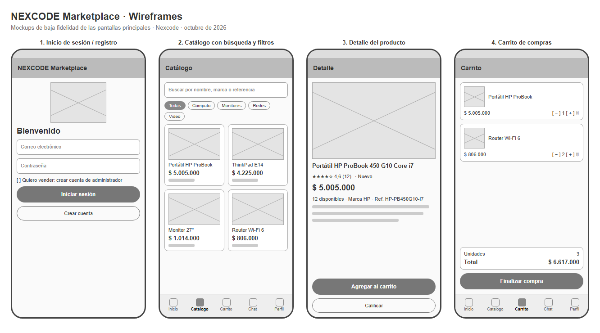

# NEXCODE Marketplace · Mockups

Wireframes de baja fidelidad de las cuatro pantallas principales. Muestran la distribución de los elementos y la navegación, no los colores ni la tipografía finales (Material 3). El archivo `mockups/wireframes.html` es editable y se abre en cualquier navegador.

| # | Pantalla | Elementos principales | Requisitos |
|---|---|---|---|
| 1 | Inicio de sesión y registro | Logo, correo, contraseña, interruptor «Quiero vender», botones de entrar y crear cuenta | RF-01, RF-02 |
| 2 | Catálogo | Buscador, chips de categoría y cuadrícula de productos con foto, nombre y precio | RF-04, RF-05 |
| 3 | Detalle del producto | Foto, nombre, calificación, estado, precio, existencias, marca, referencia y descripción; botones de carrito y calificar | RF-06, RF-07, RF-10 |
| 4 | Carrito | Líneas con cantidad (− / +) y eliminar, unidades, total y botón de finalizar compra | RF-07, RF-08 |

**Navegación:** barra inferior con cinco secciones (Inicio, Catálogo, Carrito, Chat y Perfil). El detalle del producto y el inicio de sesión son actividades aparte, sin barra inferior.

**Criterios de diseño:**
- **Botón principal único por pantalla,** relleno y abajo, al alcance del pulgar; las acciones secundarias van con contorno.
- **Precio y existencias siempre visibles** antes de agregar al carrito.
- **Imágenes con descripción** (`contentDescription`) para lectores de pantalla.
